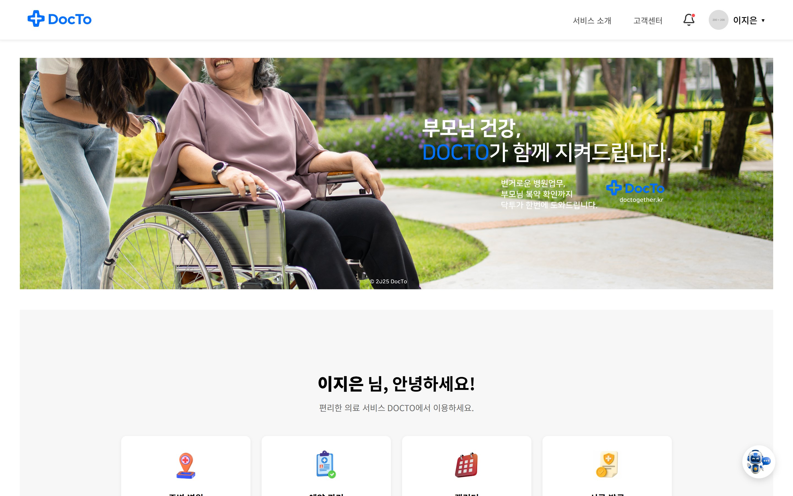
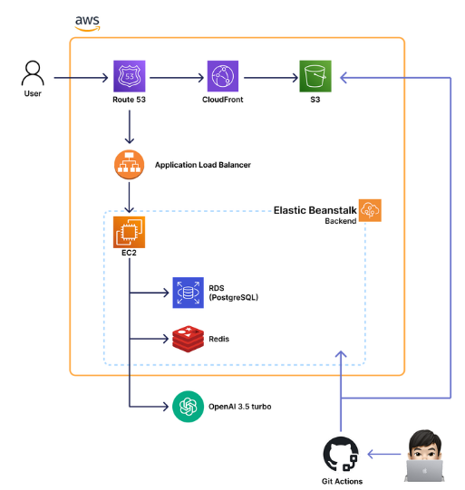
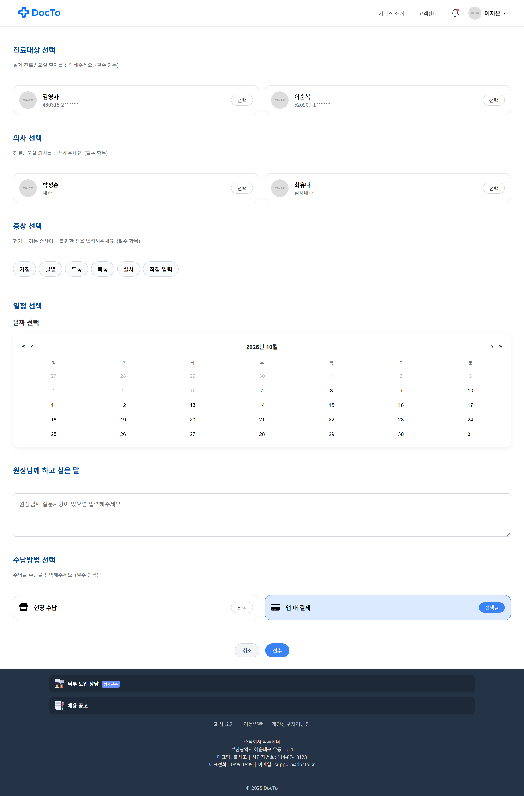
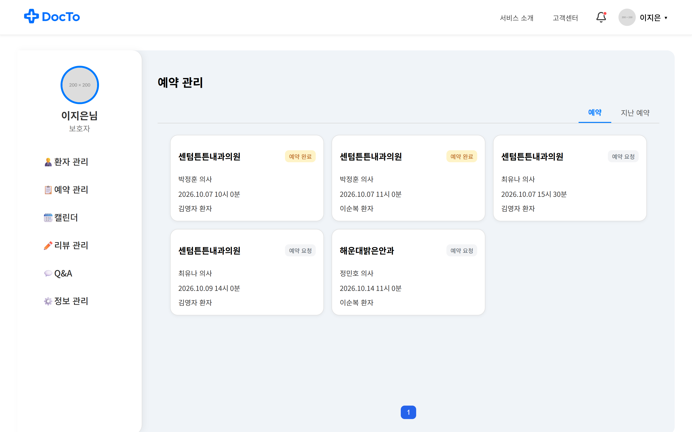
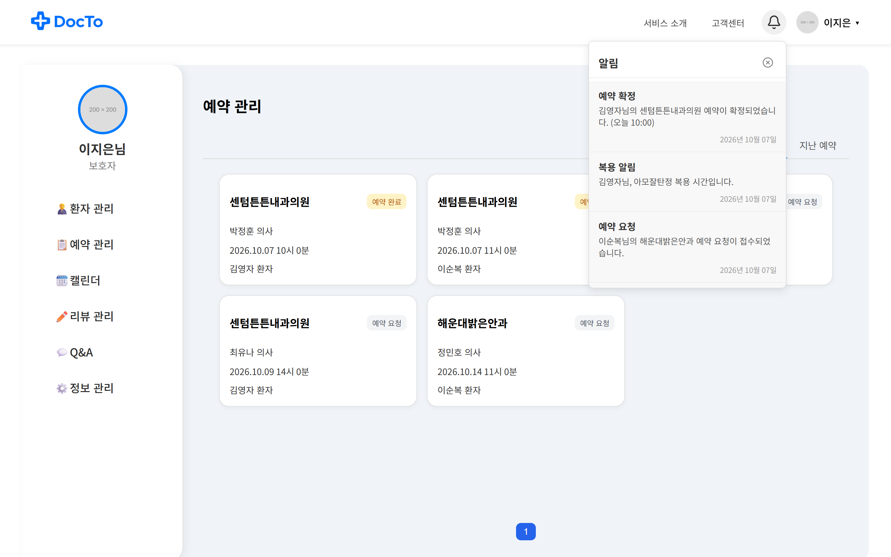
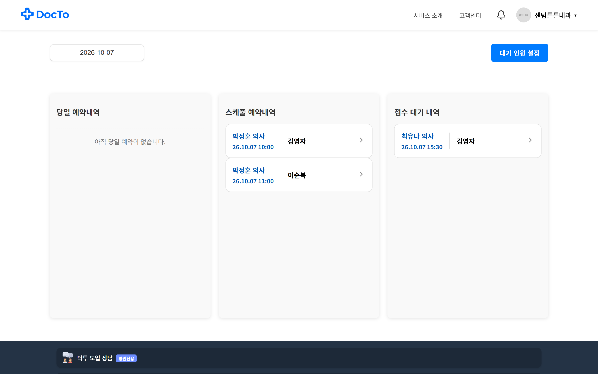
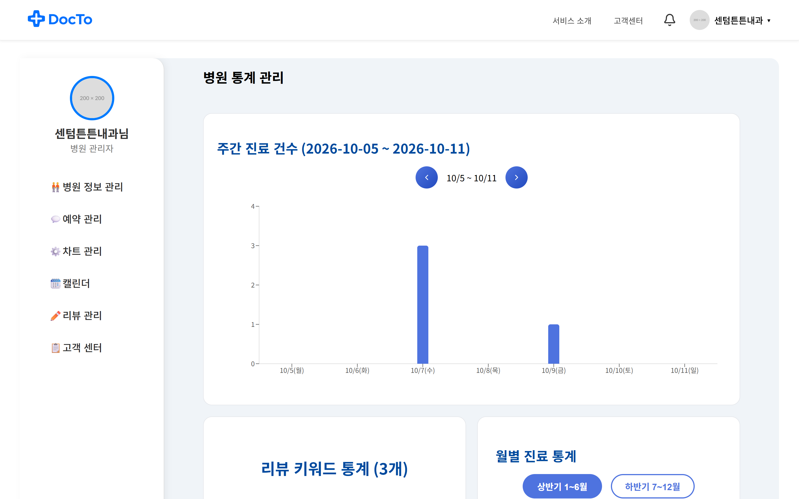
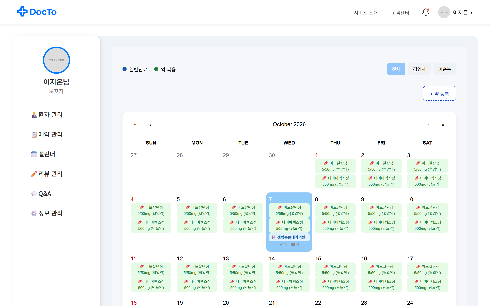

# 🏥 Docto — 고령 환자와 보호자를 위한 병원 통합 예약·건강관리 서비스

<div align="center">
  
  <br/><br/>
  <p><b>"부모님 건강, DOCTO가 함께 지켜드립니다."</b><br/>
  번거로운 병원 업무부터 부모님 복약 확인까지, 닥투가 한 번에 도와드립니다.</p>

  
  
  
  
  
  
</div>

<br/>

## 📖 프로젝트 소개

병원 예약 과정이 어려운 **고령 환자**와, 그들을 돌보는 **보호자**를 위한 병원 통합 예약·건강관리 플랫폼입니다.
보호자가 부모님(환자)을 대신해 진료를 예약하고, 복약 일정을 관리하며, 실시간 알림으로 건강을 함께 챙길 수 있도록 설계했습니다.

- 👨‍👩‍👧 **보호자 ↔ 환자 연동** — 보호자가 여러 환자(부모님)를 등록해 대신 예약·관리
- 🤖 **AI 증상 분류 챗봇** — 증상을 입력하면 적절한 진료과·병원을 추천
- 🔔 **실시간 알림** — 예약 확정, 복약 시간, 예약 요청을 WebSocket · FCM 푸시로 전달
- 🏥 **병원 관리자 기능** — 예약 접수/대기 관리, 진료 통계 대시보드 제공

- 🗓️ **개발 기간** : 2025.05 ~ 2025.07
- 🔗 **발표자료** : [📢 Docto 발표자료 (Canva)](https://www.canva.com/design/DAGr0Cdjw-Y/uj4BwFcTDeO00kiITlNGpw/view)
- 🔗 **Frontend** : [front-project](https://github.com/ssginc8-Phoenix/front-project)

<br/>

## 👥 팀원

<table>
  <tr>
    <td align="center"></td>
    <td align="center"></td>
    <td align="center"></td>
    <td align="center"></td>
    <td align="center"></td>
  </tr>
  <tr>
    <th align="center"><a href="https://github.com/OhSoomin812">오수민</a></th>
    <th align="center"><a href="https://github.com/dongdong8343">유동근</a></th>
    <th align="center"><a href="https://github.com/jaehoney01">정재헌</a></th>
    <th align="center"><a href="https://github.com/jiiinchoi">최지인</a></th>
    <th align="center">심재민</th>
  </tr>
  <tr>
    <td align="center">팀장 · BE · FE</td>
    <td align="center">BE · FE</td>
    <td align="center">BE · FE</td>
    <td align="center">BE · FE</td>
    <td align="center">BE · FE</td>
  </tr>
</table>

<br/>

## 🛠️ 기술 스택

| 분류 | 기술 |
|------|------|
| **Language** | Java 17 |
| **Framework** | Spring Boot 3.4.5, Spring Security, Spring Data JPA, QueryDSL |
| **Auth** | JWT, OAuth2(소셜 로그인), SMTP 이메일 인증 |
| **Database** | PostgreSQL, Redis |
| **Messaging / Async** | Apache Kafka, WebSocket(STOMP), Firebase Cloud Messaging(FCM) |
| **AI** | Spring AI (OpenAI GPT-3.5-turbo) |
| **Infra** | AWS (EC2 · Elastic Beanstalk · RDS · S3 · CloudFront · Route 53 · ALB), GitHub Actions |
| **Docs / Test** | Spring REST Docs(Asciidoctor), JUnit5 |

<br/>

## 🏗️ 시스템 아키텍처

<div align="center">
  
</div>

- **Route 53 → CloudFront → S3** : 프론트엔드 정적 리소스 배포
- **ALB → Elastic Beanstalk(EC2)** : 백엔드 애플리케이션 서빙 및 오토스케일링
- **RDS(PostgreSQL) · Redis** : 영속 데이터 저장 및 캐시/세션 관리
- **OpenAI GPT-3.5-turbo** : 챗봇 증상 분류·병원 추천
- **GitHub Actions** : CI/CD 자동 배포

<br/>

## 🧩 개발 전략 & 백엔드 컨벤션

- 🧪 **테스트 기반 개발(TDD)** — JUnit5 + MockMvc + Spring REST Docs(AsciiDoc)로 API 문서를 자동화하고 문서의 정확성·최신성을 유지
- 🏛️ **계층 분리** — `Controller → Service → Provider → Repository` 구조로 책임을 분리
- 🏭 **정적 팩토리 메서드** 기반 객체 생성으로 가독성·일관성 확보
- 🚨 **도메인 기반 ErrorCode 체계** — 예외를 도메인별로 표준화해 일관된 에러 응답 제공
- 💳 **안전한 결제 처리** — TossPayments 연동 시 요청 금액과 DB 금액 일치 검증(Validator 위임) + `@Transactional`로 위·변조 방지 및 데이터 정합성 확보
- 🤖 **AI + DB 결합형 추천** — 증상으로 진료과를 분류하고, DB에 적합한 병원이 없으면 AI가 직접 추천
- ⏰ **복약 모니터링 스케줄링** — 복용 알림 후 5분 내 미확인 시 미복용 로그를 생성하고 보호자에게 알림

<br/>

## ✨ 주요 기능

Docto는 **① 환자·보호자 / ② 병원 관리자·의사 / ③ 공통** 세 축으로 기능을 제공합니다.

### 👨‍👩‍👧 ① 환자 · 보호자

**👋 보호자 위임 초대 & 환자 연동** — 환자가 보호자를 **이메일로 직접 초대**해 연결하는 위임 방식으로, 보호자가 여러 환자(부모님)를 등록해 대신 관리합니다.

**📍 위치 기반 병원 검색** — 사용자 위치를 기반으로 주변 병원 리스트를 제공하고, **대기 인원**과 **리뷰 통계**를 함께 조회합니다.

**🤖 AI 증상 분류 챗봇** — 증상을 입력하면 AI가 진료과를 분류해 병원을 추천합니다. (AI + DB 결합형)

**📝 실시간 예약 서비스** — `보호자 예약 요청 → 환자 선택 → 병원 관리자 승인 → 진료 후 결제 → 리뷰·Q&A → AI 브리핑`의 전 과정을 지원합니다.

<div align="center">
  
  
</div>

**🔔 실시간 알림** — 예약 확정, 복약 시간, 예약 요청 접수 등을 WebSocket · FCM 푸시로 실시간 전달하고, 미복용 시 보호자에게 알립니다.

<div align="center">
  
</div>

**💳 결제** — 진료 후 TossPayments로 앱 내 결제를 지원하며, 금액 검증과 트랜잭션으로 위·변조를 방지합니다.

**💬 CS 실시간 채팅 상담** — WebSocket(STOMP) + Kafka 기반 실시간 채팅으로 고객 문의에 대응합니다.

### 🏥 ② 병원 관리자 · 의사

**🗂️ 병원 관리자 운영**
- 당일/스케줄 예약과 **접수 대기 관리**, **대기 인원 설정**
- **주간 진료 건수·리뷰 키워드·월별 통계** 시각화
- 악성 리뷰 신고

<div align="center">
  
  
</div>

**🩺 의사 운영**
- 보호자가 진료 시 남긴 질문에 대한 답변 (보호자는 답변 확인 가능)
- 진료 스케줄 관리 및 30분당 진료 인원 설정
- 악성 리뷰 신고

### 🧑‍🤝‍🧑 ③ 공통

**🗓️ 공유 캘린더 & 복약 관리** — 복약 등록·조회, 보호자·환자 간 일정 공유 및 알림, 날짜별 세부 일정 확인으로 중요 일정을 놓치지 않도록 관리합니다.

<div align="center">
  
</div>

**📄 서류 발급** — 보호자가 서류를 요청하면 병원 관리자가 등록하는 방식으로 진료 서류를 발급합니다.

<br/>

## 🚀 추후 개발 계획

- 🏥 **공공 마이데이터 OpenAPI 연동** — 제휴 병원 확보 후 공공데이터포털 연동으로 건강 정보 자동 조회 기능 제공
- 👥 **보호자 위임 기능 확장** — 간편 인증 기반 자동 위임, 다중 보호자 등록 지원

<br/>

## 📂 도메인 구조

```
com.ssginc8.docto
├── appointment   # 진료 예약
├── auth          # JWT / OAuth2 인증
├── calendar      # 복약·진료 캘린더
├── chatbot       # AI 증상 분류·병원 추천
├── doctor        # 의사
├── hospital      # 병원
├── guardian      # 보호자-환자 연동
├── patient       # 환자
├── medication    # 복약 관리
├── notification  # 알림
├── fcm           # FCM 푸시
├── kafka         # 이벤트 메시징
├── payment       # 결제
├── review        # 리뷰
├── qna           # Q&A
├── insurance     # 보험
├── file          # 파일(S3)
└── global        # 공통(예외·설정 등)
```
